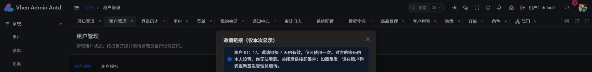
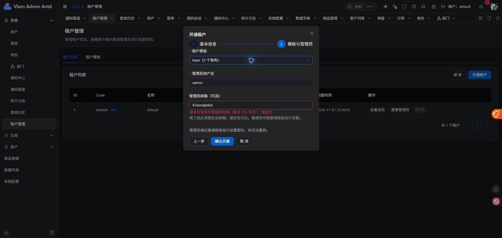
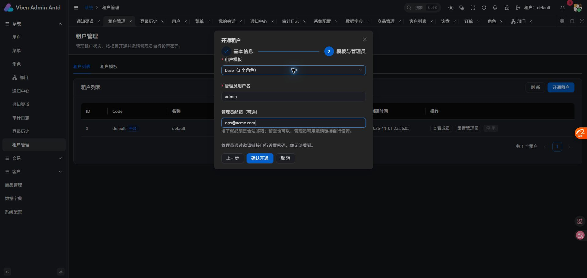

# FE-IDN-006 验收记录

实现分支：`feat/fe-idn-006-form-ux`，基线：`main` / `d658785`。任务卡：[FE-IDN-006](../../tasks/FE-IDN-006.md)。

四个输入字段沿用现有 Ant Design Vue `Form.Item` 的呈现方式，以 `validate-status` 和 `help` 显示红框及字段下方错误。非空字段 blur 时校验；有错误的字段在输入时重新校验；提交按显示顺序校验并聚焦首个错误字段。邮箱先 trim，空值合法且请求省略 `admin_email`。租户模板选择错误也放在选择器下方，顶部错误横幅由服务端异常填充。

真实联调环境为前端 `http://127.0.0.1:5666`、后端 `http://127.0.0.1:18080`，使用 Chrome 已登录的超级管理员会话。业务响应没有 mock。脱敏后的请求、响应、DOM 状态和清理结果见 [acceptance.json](acceptance.json)。

| §3 | 验收项 | 观察与证据 |
| --- | --- | --- |
| 1 | 空邮箱 | 邮箱为空且没有字段错误时提交，真实 `POST /api/v1/admin/tenants` 的请求省略 `admin_email`；响应 `201`、业务码 `0`、`tenant_id=17`，弹出邀请链接。[提交前](06-email-placeholder-real.jpg)、[开通成功](01-empty-email-success-real.jpg)、[真实列表中的租户](01-created-tenant-real.jpg)。 |
| 2 | 非法邮箱 | `47wmdyhhd` blur 后在邮箱下方显示错误，输入框红框，`aria-invalid=true`，顶部错误横幅数量为 `0`。[真实后端页面截图](02-invalid-email-real.jpg)。 |
| 3 | 实时清除 | 输入改为 `ops@acme.com`，未 blur、光标仍在邮箱中时，错误文案和红框立即清除，`aria-invalid=false`。[真实后端页面截图](03-email-cleared-real.jpg)。 |
| 4 | 提交聚焦 | Code/名称都为空时点击下一步，两个字段都显示错误，聚焦 Code；第二步用户名为空且邮箱非法时提交，聚焦用户名。[基本字段](04-basic-focus-real.jpg)、[管理员字段](07-administrator-fields-real.jpg)。组件测试同时断言 `document.activeElement`。 |
| 5 | 服务端错误 | 使用已创建的代码 `feidn006_1794869417303` 再次提交，真实响应 `409`、业务码 `10004`；顶部显示后端消息「资源冲突或仍被引用」，字段错误为 `0`。[409 截图](05-server-conflict-real.jpg)。 |
| 6 | 占位符与说明 | 邮箱占位符为「例如 ops@acme.com」；说明为「填了就必须是合法邮箱；留空也可以，管理员可用邀请链接自行设置。」[截图](06-email-placeholder-real.jpg)。 |
| 7 | 其他字段 | Code/名称/管理员用户名均显示字段下方错误和红框；顶部无校验错误。组件测试覆盖非空 blur、空 blur 不报错、输入仍非法时保留错误、改正后清除、提交必填校验。[Code/名称](04-basic-focus-real.jpg)、[用户名](07-administrator-fields-real.jpg)。 |
| 8 | 工程检查 | lint、typecheck、unit、build 全部退出 `0`。typecheck `38/38`，工作区 unit `148` 文件 / `962` 测试，admin unit `53` 文件 / `255` 测试，build `11/11`。命令及日志见下表；最终状态同时记录在 `acceptance.json`。 |

| 检查 | 命令 | 日志 |
| --- | --- | --- |
| lint | `bun run lint` | [lint.txt](lint.txt) |
| typecheck | `pnpm check:type` | [typecheck.txt](typecheck.txt) |
| unit（工作区） | `bun run test:unit --maxWorkers=2` | [unit.txt](unit.txt) |
| unit（admin） | `bun run --cwd apps/admin test:unit --maxWorkers=2` | [unit-admin.txt](unit-admin.txt) |
| build | `pnpm build:antd` | [build.txt](build.txt) |

lint 和 unit 通过 Bun 调用仓库原有脚本，使用的仍是 `vsh` / `Vitest`。默认沙箱无法读取全局 Corepack 缓存；typecheck 和 build 在自动审批允许后运行原始 pnpm 命令。日志保留了不导致失败的图标扫描、外部资源访问与 `vi.mock` 提示。

第 1、2、3 条的真实后端截图如下。成功截图截取到邀请链接文本框之前，保留租户 ID 与成功状态；邀请凭证没有写入验收文件。

本次验收仅创建租户 `17`（`feidn006_1794869417303`），完成后真实调用 `POST /api/v1/admin/tenants/17/disable` 返回 `200`，状态为 `suspended`。[清理截图](cleanup-tenant-suspended-real.jpg)。该测试租户及未激活管理员保留为停用状态；现有 API 没有租户删除操作。既有模板 `2` 没有修改，浏览器已恢复到原菜单页面。
