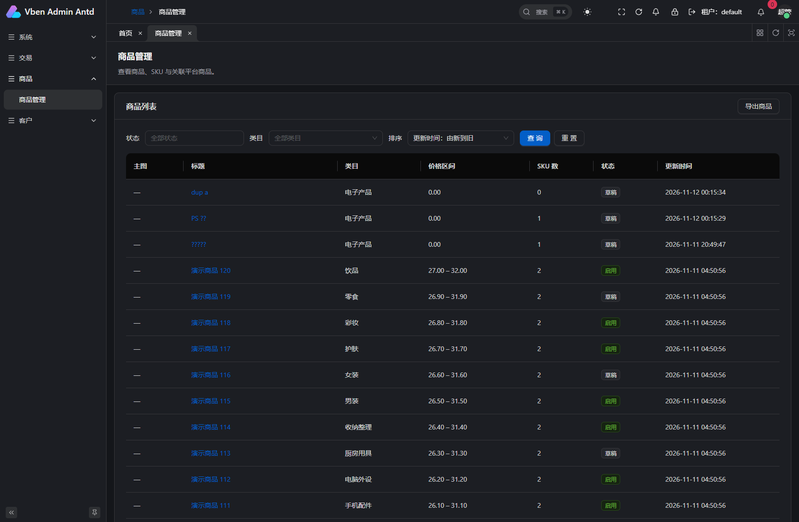
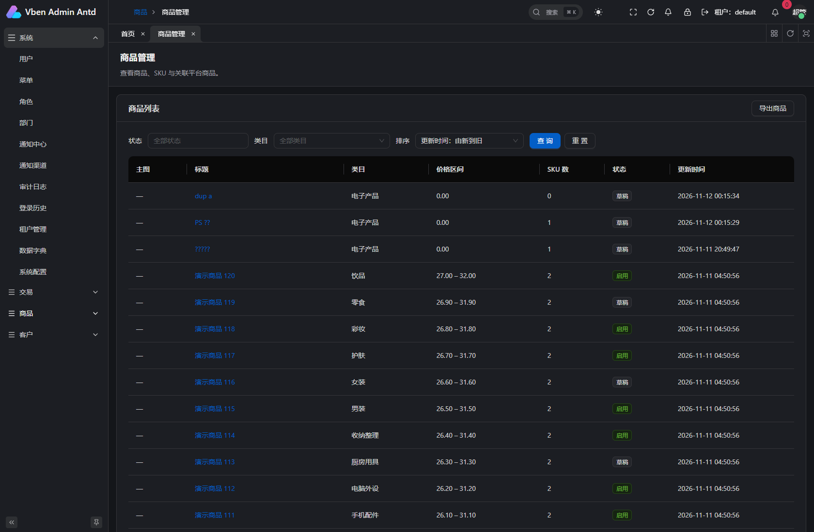
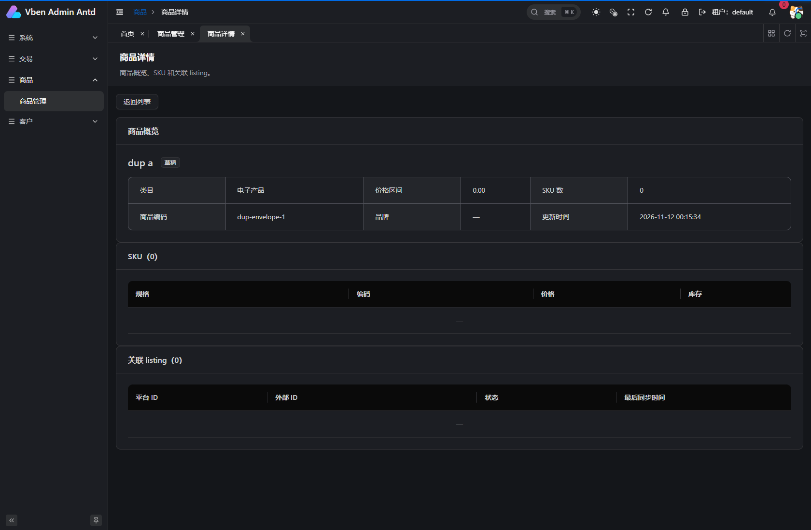
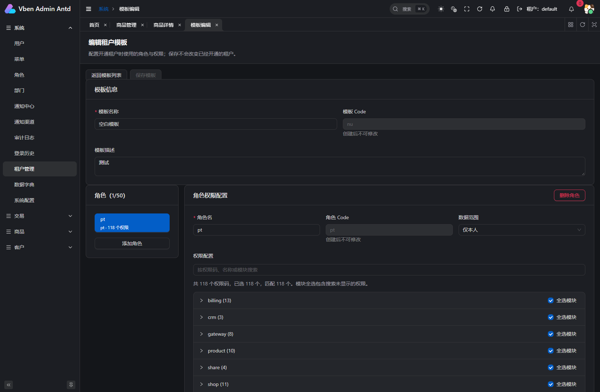
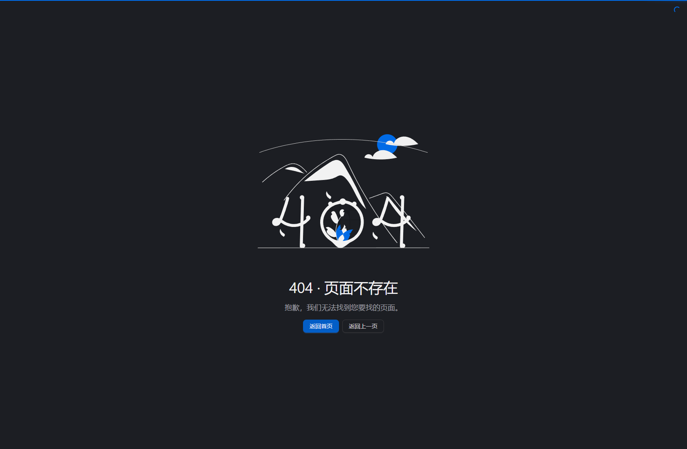

# FE-IDN-009 验收记录

分支 `feat/fe-idn-009-menu-driven`，基线 `main 6a7e585`。真实验收使用前端 `http://127.0.0.1:5669`、后端 `http://127.0.0.1:18081`；未拦截或替换接口响应。浏览器步骤、请求状态与 trace ID 见 [acceptance.json](acceptance.json)，命令输出见 [e2e.txt](e2e.txt)。

## 卡片 §3 逐项证据

| # | 验收项 | 证据 |
| --- | --- | --- |
| 1 | 文件删除 | `catalog.ts`、`configuration-menus.ts`、`tenant-menus.ts` 已删除；脚本检查文件不存在，`access.ts` 不含合成路由引用。只注册后端路由和四个 shell 页面。 |
| 2 | 菜单驱动 | 真实侧边栏显示商品下的商品管理、系统下的数据字典及系统配置，见下方两张截图。 |
| 3 | 归类 | `/auth/menus` 根目录顺序为系统、交易、商品、客户；脚本断言子项归属，侧边栏截图同时佐证。 |
| 4 | 隐藏页 | 真实投影包含商品详情、租户模板、模板编辑的 `visible=false` 行；脚本断言侧边栏无这些入口。 |
| 5 | 刷新直达 | 直接导航 `/catalog/products/124` 和 `/system/tenants/templates/15`，再整页刷新，两页均正常渲染，见下方截图。使用现有数据，无业务响应替身。 |
| 6 | 缺菜单 404 | 通过菜单 API 临时停用数据字典，使其从 `/auth/menus` 消失；管理员保留权限，直接访问并刷新 `/system/dicts` 均显示 404；随后恢复原配置并验证字典页恢复。 |
| 7 | 权限 | 真实受限账号保留菜单授权，但无 `product:spu:list`；商品菜单不可见，直接访问 404，见 [权限截图](07-no-product-permission-real.png)。 |
| 8 | 注册表覆盖 | 真实后端投影的 18 个组件引用全部解析成功；单测覆盖种子组件和未知组件，注册表原有映射不变。 |
| 9 | 租户页 | 平台管理员的租户管理、模板列表与编辑均从真实菜单生成。真实非超管账号即使拥有 tenant list/manage 权限，也无租户入口且前端直访 404；单测另覆盖非平台租户超管，见 [受限账号](09-non-platform-tenant-real.png) 与 [平台模板页](09-platform-template-menu-real.png)。 |
| 10 | 构建 | lint、全仓 typecheck、全仓及 Admin 单元测试、生产构建的命令与退出码见 `10-*.json`、`10-*.txt`；最终核对见 `verification.json`。 |

### §3.2、§3.3：商品侧边栏与目录顺序



### §3.2、§3.3：系统下的数据字典、系统配置



### §3.5：详情 URL 直接打开并刷新





### §3.6：临时移除字典投影后 404



## 实现与回归

- 移除所有业务路由合成和业务路径的 403 占位；保留审计、通知权限过滤。`menu-permissions.ts` 只过滤后端行，不创建路由，并保留平台租户身份与租户页禁用缓存的约束。
- 隐藏行注册为路由且设置 `hideInMenu`。页面节点的子页从父页面组件旁独立挂载，避免没有 `RouterView` 的列表组件占住详情；所属菜单高亮仍由后端父路径推导。
- 缺菜单即匹配全局 404；回归测试覆盖空菜单但权限完整、菜单删除后路由重建、隐藏页真实 Vue Router 匹配、租户边界及组件注册表。
- 隐藏页渲染回归先运行失败断言，再修复并通过：见 [修复前](hidden-page-regression-red.txt)、[修复后](hidden-page-regression-green.txt)。

## 已确认的后端补齐

原后端查询和 `BuildMenuTree` 同时丢弃 `visible=false` 行，与本卡直访要求冲突。用户选择“后端补齐 /auth/menus 隐藏行”后，在 `D:/code/go-admin-api` 的 `codex/fe-idn-009-hidden-menu-projection` 分支修正查询、投影及 OpenAPI，输出 `visible` 并更新菜单缓存命名空间，防止命中旧结构。相关单元/集成测试见 [后端测试](backend-hidden-menu-tests.txt)，lint 见 [退出码](backend-lint.json)。响应 envelope 保持不变，无新增表或依赖。

## AGENTS §12 清理

已清理：验收脚本 `finally` 先用 API 删除测试用户 105、角色 90（均返回 204），再执行带本卡 UA、开始时间及事务级 `audit-prune` cutoff guard 的 SQL，删除审计 17 行、会话 16 行、密码历史 2 行、已软删除用户 1 行。详细 SQL、参数和行数见 [cleanup.json](cleanup.json)。

```sql
SELECT set_config('commercehub.audit_prune_before', $1, true);
DELETE FROM audit_log
WHERE user_agent IN ($1,$2) AND created_at >= $3 AND created_at < $4
RETURNING id; -- 17 行
DELETE FROM sys_refresh_token
WHERE user_agent IN ($1,$2) AND created_at >= $3
RETURNING id; -- 16 行
DELETE FROM password_history WHERE tenant_id=1 AND user_id=$1 RETURNING id; -- 2 行
DELETE FROM auth_token WHERE tenant_id=1 AND user_id=$1 RETURNING id; -- 0 行
DELETE FROM sys_user
WHERE tenant_id=1 AND id=$1 AND username=$2 AND deleted_at IS NOT NULL
RETURNING id; -- 1 行
```

测试用户、角色、商品、模板、审计及会话剩余均为 0；本轮复用已有商品和模板，未创建租户或修改系统配置。菜单和配置快照与验收前一致，原有 17 条无关审计全部保留。前面失败轮次也均经过 `finally` 清理。

清理偏差：没有对整个开发库调用只有时间上界的 `audit-prune` CLI，而是复用同一 cutoff guard 并增加本卡精确谓词，以免删除其他任务的审计。第 6 项通过临时停用菜单，从真实授权投影中移除该行，保留原 ID 和授权关系以便原样恢复。

当前改动保留在本地功能分支，未提交、推送或合并。
