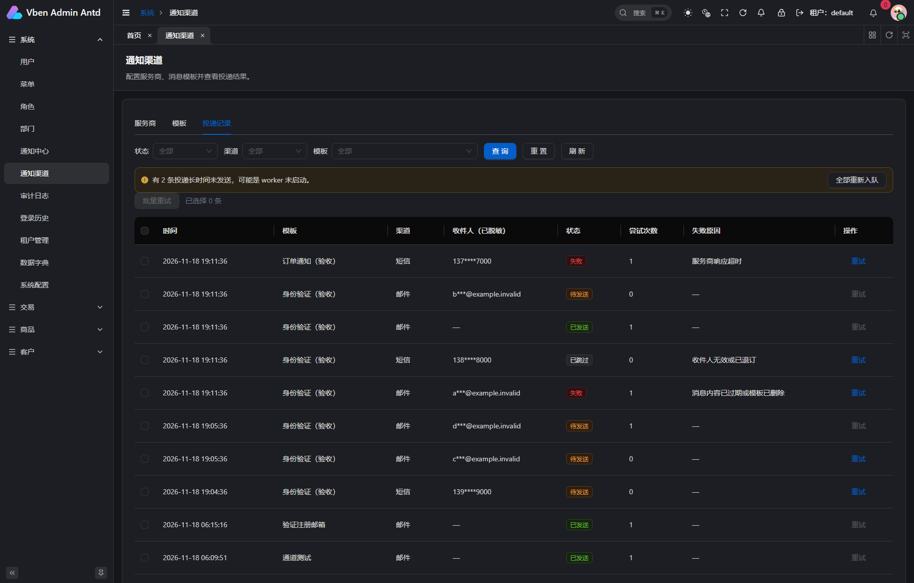

# FE-IDN-011 验收记录

验收日期：2026-11-18。分支 `feat/fe-idn-011-delivery-page`，基于 `main` / `abccf58971bb6eb7c2a80fcc20a9325067b65cea`。

本次使用运行中的真实后端 `http://127.0.0.1:18080`（包含 BE-IDN-015 / `1da2fdb`、迁移 33）及前端 `http://127.0.0.1:5666`。浏览器时区为 Asia/Shanghai，无接口拦截或模拟响应。最终完整运行的断言、请求、资源 ID、trace ID 与清理明细见 [acceptance.json](./acceptance.json)，`passed=true`、`browserErrors=[]`。

| §3 | 验收项 | 结果与证据 |
| --- | --- | --- |
| 1 | 模板列 | 中文名「身份验证（验收）」；悬浮显示 `feidn011_1795000296225.verify`。[悬浮截图](./01-template-code-tooltip-real.png)，JSON `checks[item=1]`。 |
| 2 | 收件人 | 邮箱 `a***@example.invalid`、手机 `138****8000`；旧记录 API 返回 `recipient_masked=null`，显示 `—`。[掩码截图](./02-masked-recipients-real.png)，JSON `checks[item=2]`。 |
| 3 | 状态四态 | 检查真实 DOM 标签：待发送橙色、已发送绿色、失败红色、已跳过灰色。[四态截图](./02-masked-recipients-real.png)，JSON `checks[item=3]`。 |
| 4 | 失败原因 | 显示「消息内容已过期或模板已删除」，悬浮显示 `message_unavailable`。[悬浮截图](./04-error-code-tooltip-real.png)，JSON `checks[item=4]`。 |
| 5 | 单条重试 | failed 投递 `89` 的 POST 返回 200 / pending；后续 GET 与页面均为待发送。trace `01M7Q5P6MP0C4MDNZAY5Y18S5T`。[重试截图](./05-single-retry-pending-real.png)，JSON `checks[item=5]`。 |
| 6 | 批量重试 | 勾选 failed `95`、skipped `90`、sent `91`；真实响应 `retried=2, skipped=1`，提示「成功 2 条，跳过 1 条」。trace `01M7Q5P97DJYZXPCRZD453M9AS`。[提示截图](./06-mixed-batch-retry-real.png)，JSON `checks[item=6]`。 |
| 7 | 禁用 | sent 按钮禁用，悬浮说明「已发送的投递无需重试」；不足 5 分钟的 pending 也禁用。[禁用截图](./07-disabled-sent-real.png)，JSON `checks[item=7]`。 |
| 8 | 筛选 | 状态、渠道、模板分别核对真实请求与返回每行；组合 `sent + email + 本次 verify 模板` 仅返回投递 `91`。[组合截图](./08-combined-filters-real.png)，JSON `checks[item=8]` 包含四组参数、ID 与 trace。 |
| 9 | 卡住提示 | 构造 6/7 分钟前且 `attempts=0` 的 pending `93/94`，显示「有 2 条投递长时间未发送，可能是 worker 未启动。」；全部重新入队请求仅含这两条，返回成功 2 / 跳过 0。trace `01M7Q5P409Z2Y20YT5PRGY0GYD`。[提示条截图](./09-stalled-worker-warning-real.png)，JSON `checks[item=9]`。 |
| 10 | 空态 | `skipped + email + 本次 verify 模板` 真实响应 `total=0`；显示「暂无投递记录」「通知触发后会出现在这里」。[空态截图](./10-empty-state-real.png)，JSON `checks[item=10]`。 |
| 11 | 构建 | lint / typecheck / unit / build 的命令、退出码、日志见下表及 [verification.json](./verification.json)。 |

第 2 项截图：

第 9 项截图：

另核对时间列精确到秒，Asia/Shanghai 显示 `2026-11-18 19:11:36`，悬浮为 `2026-11-18T11:11:36.754Z（UTC）`，见 [时间截图](./time-local-utc-tooltip-real.png) 和 JSON `timeDisplay`。其中 JSON `timeDisplay.utc` 保存后端原始带偏移时间，悬浮内容由浏览器断言验证。

| 检查命令（仓库根目录） | 结果 | 日志 / 退出码 |
| --- | --- | --- |
| `pnpm lint` | 退出码 0 | [lint.log](./lint.log)、[lint-result.json](./lint-result.json) |
| `pnpm check:type` | 38/38 tasks 成功 | [typecheck.log](./typecheck.log)、[typecheck-result.json](./typecheck-result.json) |
| `pnpm --filter @vben/web-antd test:unit --maxWorkers=2` | 58 文件、330 测试通过 | [unit-admin.log](./unit-admin.log)、[unit-admin-result.json](./unit-admin-result.json) |
| `pnpm test:unit --maxWorkers=2` | 153 文件、1037 测试通过 | [unit-workspace.log](./unit-workspace.log)、[unit-workspace-result.json](./unit-workspace-result.json) |
| `pnpm build:antd` | 11/11 tasks 成功 | [build.log](./build.log)、[build-result.json](./build-result.json) |
| `node --env-file=D:/code/go-admin-api/.env apps/admin/e2e/fe-idn-011.mjs` | 十项真实浏览器断言通过 | [e2e.log](./e2e.log)、[e2e-result.json](./e2e-result.json) |

单测还覆盖严格超过五分钟的边界、已安排重试的 pending、101 条跨页卡住记录、100 ID 分批、部分批次失败计数、模板跨页与中文语言优先、查询/重置/翻页清空选择及挂载期间年龄变化。工作区单测有既有 happy-dom teardown 和嵌套 `vi.mock` 警告，退出码为 0。

卡住统计独立扫描全部 pending 页，不受列表筛选或当前页限制；每次重试后重新读取列表与统计。批量接口按最多 100 ID 拆分并汇总成功/跳过数。运行中的 worker 可能在重试后立即消费，页面以刷新后的服务端状态为准；最终第 5 项已同时取得 POST、刷新 GET 和页面 pending 的证据。

可用 `pnpm --filter @vben/web-antd test:e2e:fe-idn-011` 复验，需在进程环境中提供开发库 `FE_IDN_011_DATABASE_URL`（或后端 `TEST_DATABASE_URL`）、已启动的前后端、Node/Bun 及 Edge。脚本会创建唯一前缀的一次性用户、两个模板和八组投递/outbox，密码随机且不写入证据；在 finally 中清理。为保护原数据，发现已有卡住记录时拒绝执行「全部重新入队」验收。合成 outbox 不含明文收件人。

清理按 `D:/code/go-admin-api/AGENTS.md` §12 执行，作用于本地开发库。每次运行以专用 User-Agent、创建时间、用户 ID、模板 code 和记录 ID 限定删除范围，按依赖顺序硬删除合成夹具及会话。实际 SQL、参数和逐条影响行数见 [cleanup.json](./cleanup.json)；最终完整运行共删除 28 行：

| 删除 SQL（参数见 JSON） | 最终运行影响行数 | 含调试五次运行合计 |
| --- | --- | --- |
| `DELETE FROM audit_log WHERE user_agent IN ($1,$2) AND created_at>=$3 AND created_at<$4 RETURNING id` | 6 | 19 |
| `DELETE FROM sys_refresh_token WHERE user_id=$1 AND user_agent IN ($2,$3) AND created_at>=$4 RETURNING id` | 2 | 8 |
| `DELETE FROM password_history WHERE tenant_id=1 AND user_id=$1 RETURNING id` | 0 | 0 |
| `DELETE FROM auth_token WHERE tenant_id=1 AND (user_id=$1 OR created_by=$1) RETURNING id` | 0 | 0 |
| `DELETE FROM notify_outbox WHERE tenant_id=1 AND id=$1 AND template_code=$2 RETURNING id` | 8 | 40 |
| `DELETE FROM notify_delivery WHERE tenant_id=1 AND id=$1 AND template_code=$2 RETURNING id` | 8 | 40 |
| `DELETE FROM notify_template WHERE tenant_id=1 AND id=$1 AND code=$2 RETURNING id` | 2 | 10 |
| `DELETE FROM sys_user_role WHERE tenant_id=1 AND user_id=$1 RETURNING role_id` | 1 | 5 |
| `DELETE FROM sys_user WHERE tenant_id=1 AND id=$1 AND username=$2 RETURNING id` | 1 | 5 |

审计删除前在事务内设置 `SELECT set_config('commercehub.audit_prune_before',$1,true)`。五次运行共删除 127 行，逐次记录为 [首次](./cleanup-first-run.json)、[交互调试](./cleanup-interaction-failure.json)、[选择器调试](./cleanup-selector-failure.json)、[worker 竞争复验](./cleanup-worker-race.json)、[最终运行](./cleanup.json)。五份均 `baselinePreserved=true`，用户、模板、投递、outbox、会话、审计余量均为 0。

已清理：在后端仓库运行 `go run ./cmd/cli audit-prune --before 2026-11-18T11:14:02.3794858+00:00` → `deleted=0`、退出码 0（本卡审计已按限定范围删除，执行前全库审计数为 0）。见 [命令记录](./audit-prune-command.json) 和 [CLI 输出](./audit-prune.log)。[清理复核](./cleanup-verify.json) 确认全部 `feidn011_*` 测试资源为 0，卡住记录为 0，原有投递恢复为 failed=51 / sent=3。原用户、配置、渠道 provider、菜单、租户、角色、模板、投递与 outbox 的逐行哈希校验一致；保留测试数据为零。

保留调试证据便于审阅：首次直接用 Bun 启动 Playwright 超时，改为 Node；两次修正 AntD 按钮空格/虚拟模板下拉选择器；一次运行中的 worker 在刷新前已消费 pending，随后按相同严格断言完整复验通过。相应 `acceptance-*-failure.json`、`acceptance-worker-race.json` 与 `e2e-*.log` 只记录调试过程；最终结论以无后缀的 `acceptance.json` 为准。`cleanup-browser-launch-failure.json` 是首次 finally 清理后的零删除复查，缺少原基线所以 `baselinePreserved=false`，其原始有效基线校验在 `cleanup-first-run.json`。
