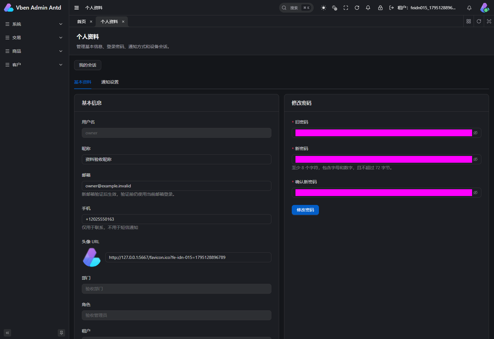
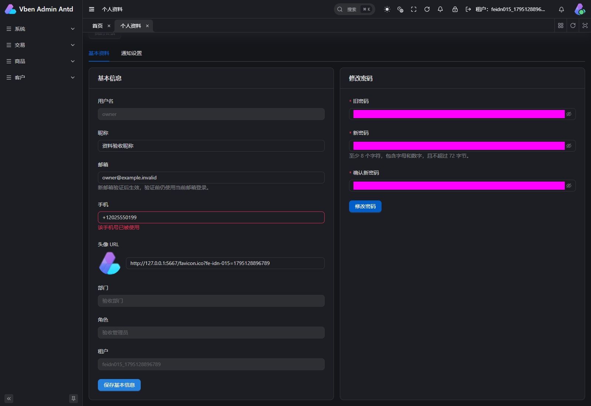
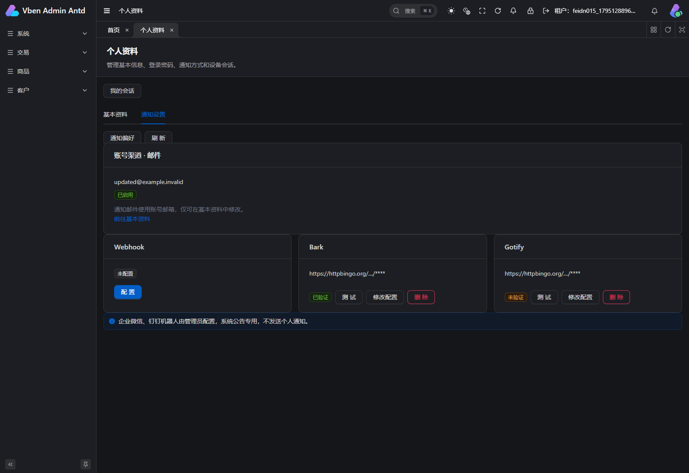

# FE-IDN-015 验收证据

- 日期：2026-11-20（Asia/Shanghai）。
- 分支：`feat/fe-idn-015-profile-editable`，基线 `main 3a7d566`。
- 前端使用生产构建与 hash 路由；真实 API、通知 worker、SMTP 接收器和 Bark HTTP 投递均参与验收，没有模拟业务响应。
- 后端工作区为 `D:/code/go-admin-api`，当前 `ed695bb` 包含约定的 `acae5f0`；本卡未修改后端。
- [浏览器结构化结果](acceptance.json)：`passed=true`，页面错误为空；[检查命令与退出码](verification.json)。

## 九条验收

| # | 断言与实际结果 | 证据 |
| --- | --- | --- |
| 1 | 昵称 PUT 200，右上角与资料页立即同步。 | [截图](01-nickname-global.png)、`acceptance.json` item 1 |
| 2 | 邮箱申请 202；真实 SMTP 接收邮件。验证前旧邮箱登录 200；匿名验证 200 后旧邮箱 401、新邮箱经页面登录 200。页面显示新邮箱、自动跳登录并保留企业代码；token 从 URL 和 history state 清除，复用返回 400。 | [待验证](02-email-pending.png)、[验证成功](02-email-verified.png)、[新邮箱登录](02-new-email-login.png)、`acceptance.json` item 2 |
| 3 | 手机可编辑；错误格式由本地 E.164 校验拦截（0 次写入），合法号码 PUT 200、刷新仍回显；另有真实占用号码 409。 | [格式错误](03-phone-invalid.png)、[编辑保存成功](03-phone-saved.png)、[409 冲突](04-phone-conflict.png)、`acceptance.json` item 3 |
| 4 | 手机冲突返回 409，字段原样显示后端文案「该手机号已被使用」。 | [409 文案截图](04-phone-conflict.png)、`acceptance.json` item 4 |
| 5 | HTTP(S) 头像 URL 图片加载成功，圆形预览；保存后右上角头像立即同步。 | [头像截图](05-avatar-preview.png)、`acceptance.json` item 5 |
| 6 | 通知设置 tab 展示邮件 / Webhook / Bark / Gotify 四张真实卡片。独立页与 tab 共同使用 `notification-setting.vue`，原占位已替换。 | [四渠道状态截图](06-notification-tab.png)、`acceptance.json` item 6 |
| 7 | 邮件已启用、Webhook 未配置、Bark 已验证、Gotify 未验证；配置入口可用。Bark 实际投递记录 id=3，状态 sent。 | [渠道状态](06-notification-tab.png)、`acceptance.json` item 7 |
| 8 | 全页无短信渠道选项；手机提示「仅用于联系，不用于短信通知」。未新增配额、定价条件。 | [手机提示](03-phone-saved.png)、[四渠道](06-notification-tab.png)、`acceptance.json` item 8 |
| 9 | lint、应用 typecheck、应用单测 66 文件 / 435 项、全工作区单测 161 文件 / 1142 项、生产 build 均退出 0。链接规范化补充回归 6 项通过。 | [lint](lint.txt)、[typecheck](typecheck.txt)、[应用单测](unit-app.txt)、[工作区单测](unit-workspace.txt)、[链接回归](unit-link.txt)、[build](build.txt)、[退出码](verification.json) |

第 3 条：手机编辑保存与真实 409。





第 6 条：通知 tab 四渠道状态。



## 复现

在仓库根目录运行，前提为现有本地 PostgreSQL、Redis 服务可用，以及 Edge 已安装：

```powershell
pnpm --filter @vben/web-antd build
bun --env-file=D:/code/go-admin-api/.env apps/admin/e2e/fe-idn-015-runtime.mjs
```

runtime 脚本构建当前 Go API / CLI / worker，在配置的本地开发数据库创建独立 schema；通过 Node 运行 Playwright，使用生产预览 5667、独立 API 18081 和 worker。浏览器请求只转发到真实 API，SMTP 和 Bark 接收器均为本机验收接收端。手机使用保留的虚构 NANP 555-0100～0199 号码，邮箱使用 example.invalid。截图遮蔽密码和推送凭据；证据不保存验证 token。

直接执行 `pnpm --filter @vben/web-antd test:e2e:fe-idn-015` 使用已启动的服务；建议按上面的 runtime 命令获得隔离和完整清理。

## AGENTS §12 清理

数据库名虽为 `commercehub_test`，它是本机原有服务配置的持久开发库；此次使用其独立 schema `feidn015_runtime_1795128885548`，并非以 CI 自动销毁代替阶段清理。

先清理没有删除 API 的投递历史，再走 API 删除 provider、个人渠道、用户、角色、菜单及关联；其后按 tenant/time 定向 SQL 清理软删除残留、认证记录、outbox 与租户。所有 SQL 和影响行数见 [cleanup.json](cleanup.json)，API 状态见 [acceptance.json](acceptance.json) 的 `apiCleanup`。

审计定向删除使用 tenant_id=2，时间范围 `[2026-11-19T22:54:56.789Z, 2026-11-19T22:55:17.459Z)`，并设置 `commercehub.audit_prune_before`。runtime 随后在同一独立 schema 执行 `cli.exe audit-prune --before <运行时当前 RFC3339>`，实际输出 [deleted=0](audit-prune.txt)，因为本卡 55 条审计已按租户清掉。

| SQL（本次 tenant_id=$1=2） | 影响行数 |
| --- | --- |
| `DELETE FROM notify_outbox WHERE tenant_id=$1 RETURNING id` | 3 |
| `DELETE FROM notify_delivery WHERE tenant_id=$1 RETURNING id` | 3 |
| `DELETE FROM audit_log WHERE tenant_id=$1 AND created_at >= $2 AND created_at < $3 RETURNING id` | 55 |
| `DELETE FROM sys_refresh_token WHERE tenant_id=$1 RETURNING tenant_id` | 8 |
| `DELETE FROM auth_token WHERE tenant_id=$1 RETURNING tenant_id` | 1 |
| `DELETE FROM sys_user_role WHERE tenant_id=$1 RETURNING tenant_id` | 1 |
| `DELETE FROM sys_role_permission WHERE tenant_id=$1 RETURNING tenant_id` | 119 |
| `DELETE FROM sys_user WHERE tenant_id=$1 RETURNING tenant_id` | 3 |
| `DELETE FROM sys_role WHERE tenant_id=$1 RETURNING tenant_id` | 1 |
| `DELETE FROM sys_permission WHERE tenant_id=$1 RETURNING tenant_id` | 119 |
| `DELETE FROM sys_dept WHERE tenant_id=$1 RETURNING tenant_id` | 1 |
| `DELETE FROM sys_setting WHERE tenant_id=$1 RETURNING tenant_id` | 1 |
| `DELETE FROM outbox_event WHERE tenant_id=$1 RETURNING tenant_id` | 34 |
| `DELETE FROM tenant WHERE id=$1 AND code=$2 RETURNING id` | 1（code=feidn015_1795128896789） |

其余 0 行 SQL 也完整记录在 cleanup.json。清理后核对 24 张相关表，本卡记录均为 0；原数据基线与原配置保持一致。停止三个自建进程后删除本卡 schema；Redis DB15 在使用前确认为空，仅清空本卡独占 DB15 的 55 个 key，结束为 0。见 [runtime.json](runtime.json)。

首次复用原有共享运行环境时，邮件投递失败，未将那次结果记为通过；该次 tenant=51、users=180/181/182、provider=22 已完全清理，原有 13 条审计保留，共享 Redis DB0 只删除本卡的 2 个 authz key。[首次清理](prior-attempts/cleanup-smtp-failure.json)、[共享资源复核](shared-cleanup-verification.json)；其余尝试的记录收于 `prior-attempts/`。

[最终只读复核](final-resource-check.json)：本卡 schema、租户、独占 Redis key、共享本卡 key 均为 0，原有 13 条审计保留。5667 / 18081 无监听；原来的 5666 / 18080 与 worker 进程仍在。未改动现有系统配置、provider；未保留测试数据。

已清理：API DELETE + tenant/time 定向 SQL + 独立 schema 的 `audit-prune --before` + 删除自建 schema / 清空独占 Redis DB15 → 24 张表本卡记录为 0，原数据保留，临时进程已停止。

全量 lint 有现有图标名称提示，工作区单测有 happy-dom AbortError 与 sortable mock 提示；均退出 0，未出现失败测试。
