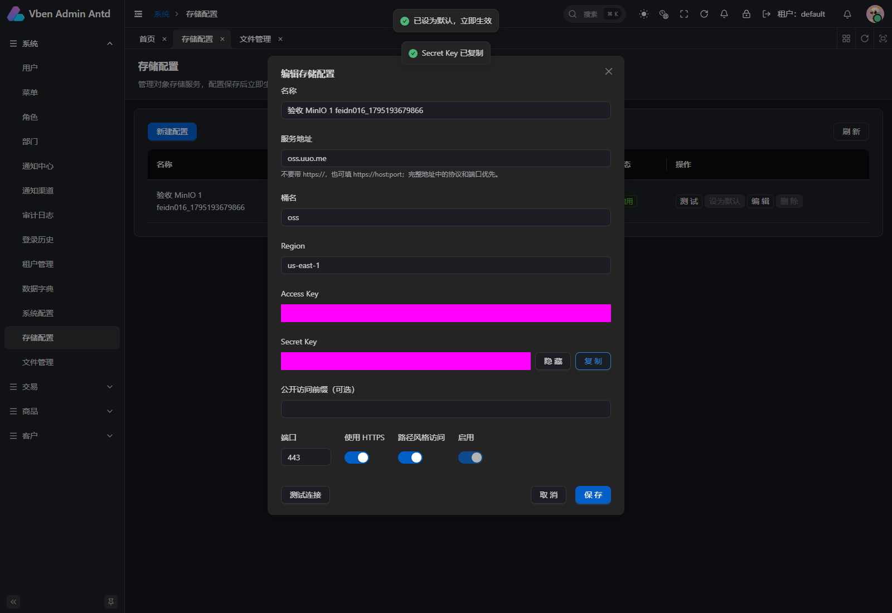
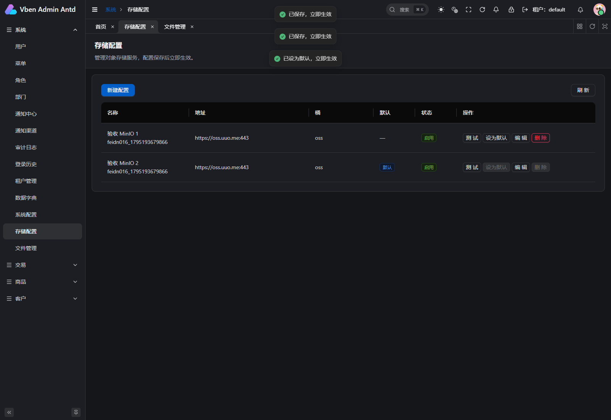
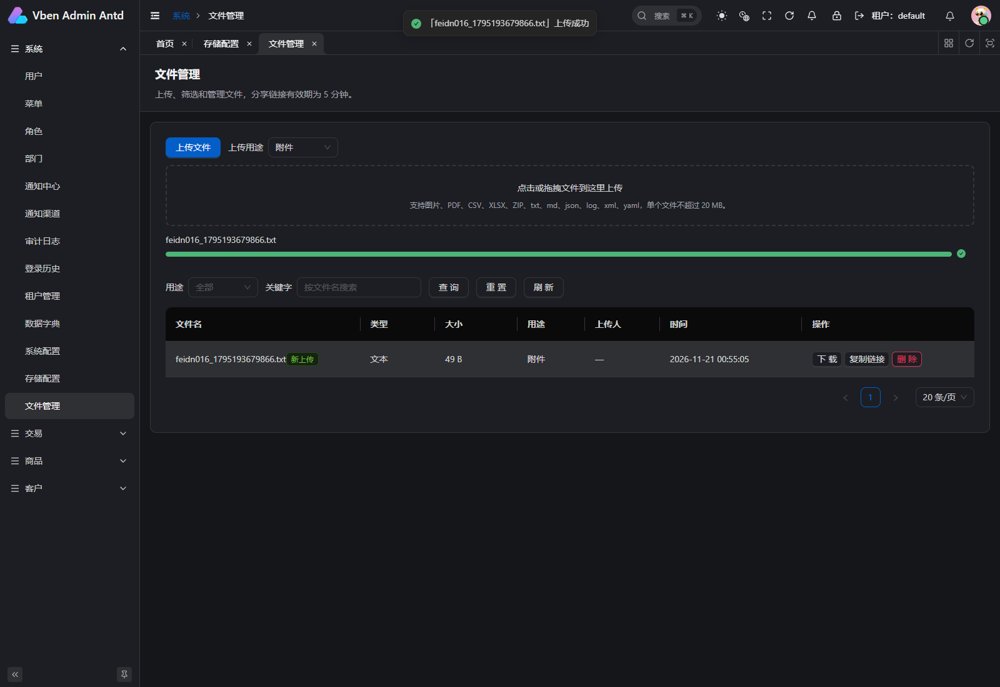

# FE-IDN-016 验收记录

十四项验收均通过。分支 `feat/fe-idn-016-storage`，基线 `03b88c5`。后端 `40ee3d7`、迁移 38；使用真实 MinIO。浏览器以生产构建运行，API 请求转发到隔离的真实后端，没有模拟业务响应。

## 十四项逐条证据

第 1–13 项的断言、HTTP 状态和请求记录见 [acceptance.json](acceptance.json)，浏览器执行输出见 [browser.txt](browser.txt)。第 14 项命令、退出码和日志见 [verification.json](verification.json)。

| # | 项目 | 结果与证据 |
| --- | --- | --- |
| 1 | 列表 | 配置名称、HTTPS 地址、桶、启用状态、唯一默认标记均显示；[列表截图](01-list-real.png)。 |
| 2 | 新建 | 从弹窗保存返回 201，列表出现；真实 MinIO 测试返回 `ok`，显示「连接正常」；[截图](02-create-test-real.png)。 |
| 3 | Secret 明文 | 编辑框初始 `type=text`；在内存中断言内容及剪贴板均等于 API 明文；隐藏/显示依次为 `password/text`；[必需截图](03-secret-visible-copy-real.png)。截图遮住实际 Access/Secret 内容，保留显示和复制控件及成功提示。 |
| 4 | 测试失败 | 保存错误密钥后，真实接口返回 `access_denied`，页面显示「认证失败」；随后恢复正确密钥；[截图](04-auth-failed-real.png)。 |
| 5 | 多配置 | 新建两条，切换第二条为默认；断言旧配置默认标记 0 个、新配置 1 个；[必需截图](05-switch-default-real.png)。 |
| 6 | 默认保护 | 默认配置删除按钮禁用，悬浮显示「请先切换默认配置」；[截图](06-default-protection-real.png)。 |
| 7 | 上传 | 原生 `DataTransfer/DragEvent` 拖入 txt；真实接口返回 201，SHA-256 匹配，进度到 100%，列表出现并标记「新上传」；[必需截图](07-drag-upload-real.png)。 |
| 8 | 超限/类型 | 20 MiB + 1 字节与 html 扩展名前端拦截，无上传请求；伪装 txt 的 HTML 经后端返回 400，页面包含原始「不支持的文件类型：text/html」及 `details.allowed`；[截图](08-upload-rejection-real.png)。 |
| 9 | 下载 | 通过认证接口下载，浏览器建议文件名等于原文件名，49 字节内容逐字节匹配原始上传数据；见 `checks.item=9`。 |
| 10 | 复制链接 | 点击时重新请求预签名接口，提示 5 分钟；剪贴板链接在新标签返回 200 并触发附件下载，内容逐字节匹配；见 `checks.item=10`。证据不保存可用签名 URL。 |
| 11 | 删除 | 出现二次确认，确认后 DELETE 返回 204、行消失；同时验证关键字查询及重置；[截图](11-delete-real.png)。 |
| 12 | 空态 | 无配置时显示配置引导；无文件时显示上传及配置引导；[配置空态](12-storage-empty.png)、[文件空态](12-files-empty.png)。 |
| 13 | 权限 | 独立会话只读用户无 storage 权限，直接访问显示 404，API 亦为 404；无 file 权限时隐藏上传/删除且不请求受保护列表，API 直接访问为 403；[404 截图](13-storage-404-real.png)、[文件权限截图](13-files-permission-real.png)。 |
| 14 | 构建 | `lint`、admin `typecheck`、全仓 unit、admin unit、admin production build；完整命令与退出码见 [verification.json](verification.json)，日志在同目录 `verification/`。 |







## 接口约束与菜单接入

- 测试接口只接受已保存的 provider ID。新建或编辑后未保存时，弹窗提示「请先保存配置后测试连接」；保存后可从列表或重新打开编辑弹窗测试。
- 当前文件 API 没有上传人字段。上传人列显示 `—`，悬浮说明接口暂未提供；不推测用户名。
- 延续 FE-IDN-009 的菜单投影约定，页面组件注册到白名单，由后端菜单决定实际路由。当前后端种子未包含这两项菜单；上线时在系统菜单管理中配置下表并授予对应角色。验收仅在隔离 schema 内创建菜单，结束后删除。

| 路径 | 组件 | 权限/可见性 |
| --- | --- | --- |
| `/system/storage` | `system/storage/index` | `system:storage:manage`，仅平台租户；无权 404；强制关闭页面缓存。 |
| `/system/files` | `system/files/index` | 数据与操作遵守 `system:file:manage`；如需无权限用户看到说明，可授予此菜单但不授予管理权限。 |

Secret 初始明文、可复制及隐藏，仅保存在页面内存；离开页面清空。上传支持后端约定的图片/PDF/CSV/XLSX/ZIP/txt/md/json/log/xml/yaml/svg，20 MiB 上限；Windows 空 MIME 可按扩展名提交，常见 CSV/ZIP/YAML/Markdown/ICO/BMP MIME 别名按匹配扩展名转换，保留原始字节、文件名和修改时间。真实 API 已验证 `application/vnd.ms-excel` 的 CSV 上传返回 201、识别为 `text/csv`；最终内容类型仍由后端校验。二进制下载保留认证刷新与统一错误处理。

## AGENTS §12 清理

本次在本地开发 PostgreSQL 中创建专用 `feidn016_runtime_<timestamp>` schema；Redis 使用初始为空的独占 DB 14。原有 public schema 的真实配置、用户、菜单及审计均保留。

1. 可经 API 删除的文件、存储配置、用户、角色、菜单全部走真实 API；文件删除等待 worker 的 `file.cleanup` 完成，原 MinIO 对象 URL 再次访问为 404。
2. SQL 清除测试用户的刷新会话、软删残留和已发送清理事件；实际 SQL、参数与影响行数见 [cleanup.json](cleanup.json)。最近成功运行中刷新会话 2 行、用户残留 1 行、已发送事件 2 行，其余关联残留 0 行；存储配置和文件各剩余 0 行。
3. 在专用 schema 上执行 `cli.exe audit-prune --before <当前 RFC3339>`，输出见 [audit-prune.txt](audit-prune.txt)；随后盘点各表、删除专用 schema、清空独占 Redis DB，并停止本次拥有的 API/worker/preview 进程。
4. [runtime.json](runtime.json) 记录完整 schema 名、`DROP SCHEMA ... CASCADE` 语句、删除前行数、Redis 删除键数和清理后 0 值；public 11 张业务表逐行哈希未变，原有审计逐行哈希保留。[最终资源检查](resource-check.json) 确认所有本卡 schema 为 0、Redis DB 14 为 0，本次端口 5667/18081 关闭，共享开发端口 5666/18080 仍在。

未保留测试业务数据或可用预签名链接。早期失败运行的隔离资源也已清理，回执保存在 `prior-attempts/`；以根目录最近成功的 `acceptance.json`、`cleanup.json`、`runtime.json` 为最终结果。

## 复现

已有本地 PostgreSQL、Redis、后端环境文件和可连接的真实 MinIO 配置时，在仓库根目录运行：

```powershell
pnpm -F @vben/web-antd build
bun --env-file=D:/code/go-admin-api/.env apps/admin/e2e/fe-idn-016-runtime.mjs
```

运行器默认使用后端 `127.0.0.1:18081`、预览 `127.0.0.1:5667`、Redis DB 14。它拒绝复用非空 Redis DB，不输出凭据，结束自动清理专用资源。可用 `FE_IDN_016_BACKEND_ROOT` 指定另一个后端仓库位置。

全仓单元测试使用 `pnpm test:unit --maxWorkers=4`，避免本机并发工作进程耗尽资源。最终通过日志保留现有 happy-dom 清理及 sortable mock 的非失败提示；此前资源耗尽的失败运行不计入通过结果。
