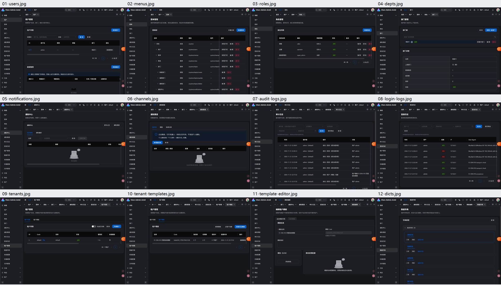
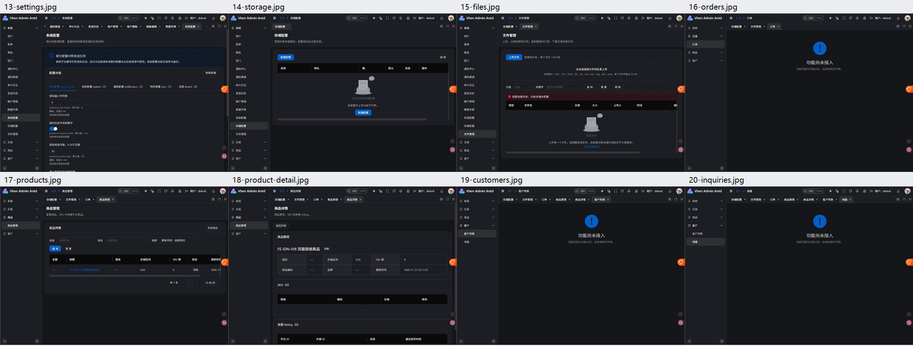

# FE-IDN-018 验收证据

分支：`feat/fe-idn-018-registry`，基线：`ad8c47a`。本卡实现后停止并报告，未推送或创建 PR。

## §3 六项验收

| # | 结果 | 证据 |
| --- | --- | --- |
| 1 简写键 | 通过。注册表只存简写键，无前导 `/`、无 `.vue`。保留明确的非 index 页面名称 | [注册表](../../../apps/admin/src/router/component-registry.ts)、[注册表测试](../../../apps/admin/src/router/__tests__/component-registry.test.ts) |
| 2 归一化 | 通过。简写、前导 `/`、`.vue`、两者组合、多个前导 `/`、旧 `views/`、`src/views/` 共 7 组输入指向同一 loader | 注册表测试 `normalizes %s to the same explicit loader`；兼容分支注明 2027-02-28 后删除 |
| 3 未知键 | 通过。11 组未知/缺失/原型名输入返回 forbidden 并 warn；`system/user` 不补 `/index`；错误路由禁用缓存，实际 Vben 路由使用 forbidden loader | [菜单集成测试](../../../apps/admin/src/router/__tests__/menus.test.ts)、[路由单测输出](router-unit.txt) |
| 4 后端契约 | 通过。fixture 来自后端 `23872a6c572d8e2253fa65c82f83b590e049c000` 的 `internal/modules/identity/seed_catalog.go`，20 页含 3 个隐藏页。当前后端 seed 与该提交无差异；实际接口的 path/component/visible 全量相等，所有页面生成真实路由 | [fixture](../../../apps/admin/src/router/__tests__/fixtures/backend-seed-menus.json)、[接口比对](backend-menu-contract.json)、[运行记录](runtime.json) |
| 5 全部页面 | 通过。逐个点击 17 个可见菜单；通过租户模板 tab、编辑模板按钮、商品链接打开 3 个隐藏页。每页保留原始截图，见下表 | [截图清单及捕获时间](screenshots.json)；截图 01–20 |
| 6 构建检查 | 通过。完整 lint、管理端 typecheck、全仓 unit、管理端 production build | [命令及退出码](checks.json)、[lint](lint.txt)、[typecheck](typecheck.txt)、[unit](unit.txt)、[build](build.txt) |

Vben 的内部 page map 仍要求 `/${key}.vue`，仅在 `access.ts` 边界转换；路由生产者和公开注册表均使用简写。没有模糊匹配或自动补 `/index`。

## 逐个页面截图

所有 URL 均在 `http://127.0.0.1:5667/#` 下。隐藏页中的 ID 1 是本卡创建且已清理的测试数据。目录通过展开验证，button 类型不产生页面。

| # | 菜单 / 打开动作 | 路径 | 可见结果 | 原始截图 |
| --- | --- | --- | --- | --- |
| 01 | 系统 → 用户 | `/system/users` | 用户列表、邀请管理 | [截图](01-users.jpg) |
| 02 | 系统 → 菜单 | `/system/menus` | 菜单树，component 为后端简写 | [截图](02-menus.jpg) |
| 03 | 系统 → 角色 | `/system/roles` | 默认 3 个角色列表 | [截图](03-roles.jpg) |
| 04 | 系统 → 部门 | `/system/depts` | 部门树及详情 | [截图](04-depts.jpg) |
| 05 | 系统 → 通知中心 | `/system/notifications` | 站内通知空列表 | [截图](05-notifications.jpg) |
| 06 | 系统 → 通知渠道 | `/system/notifications/channels` | 渠道、模板、投递记录入口 | [截图](06-channels.jpg) |
| 07 | 系统 → 审计日志 | `/system/audit-logs` | 审计记录及筛选 | [截图](07-audit-logs.jpg) |
| 08 | 系统 → 登录历史 | `/system/login-logs` | 登录记录及筛选 | [截图](08-login-logs.jpg) |
| 09 | 系统 → 租户管理 | `/system/tenants` | 默认租户列表 | [截图](09-tenants.jpg) |
| 10 | 租户管理 → 租户模板 tab（隐藏页） | `/system/tenants/templates` | 本卡验收模板列表 | [截图](10-tenant-templates.jpg) |
| 11 | 租户模板 → 编辑模板（隐藏页） | `/system/tenants/templates/1` | 模板信息、角色权限配置 | [截图](11-template-editor.jpg) |
| 12 | 系统 → 数据字典 | `/system/dicts` | 8 个系统字典及业务字典 | [截图](12-dicts.jpg) |
| 13 | 系统 → 系统配置 | `/system/settings` | 配置分组和安全配置 | [截图](13-settings.jpg) |
| 14 | 系统 → 存储配置 | `/system/storage` | 未配置对象存储空态 | [截图](14-storage.jpg) |
| 15 | 系统 → 文件管理 | `/system/files` | 上传、筛选、文件表格及未配置存储提示 | [截图](15-files.jpg) |
| 16 | 交易 → 订单 | `/trade/orders` | 既有“功能尚未接入”占位页 | [截图](16-orders.jpg) |
| 17 | 商品 → 商品管理 | `/catalog/products` | 本卡验收商品列表 | [截图](17-products.jpg) |
| 18 | 商品列表 → 商品链接（隐藏页） | `/catalog/products/1` | 商品概览、SKU、关联 listing | [截图](18-product-detail.jpg) |
| 19 | 客户 → 客户列表 | `/crm/customers` | 既有“功能尚未接入”占位页 | [截图](19-customers.jpg) |
| 20 | 客户 → 询盘 | `/crm/inquiries` | 既有“功能尚未接入”占位页 | [截图](20-inquiries.jpg) |

补充：[首页](00-home.jpg)正常渲染。[浏览器控制台](browser-console.json)保留原始记录；采集到浏览器扩展的“Receiving end does not exist”噪声，未出现注册表 unknown 或动态组件加载错误。截图中右侧采购助手浮标来自本机扩展。

## AGENTS §12 清理

验收使用开发 PostgreSQL 中独占的 `feidn018_runtime_1795270630026` schema，以及初始为空的 Redis DB13，未改动 public 配置。浏览器验收较长，原清理脚本令牌过期；恢复清理时发现商品归档需要 version 参数，修正后通过。失败记录保留在 [prior-attempts](prior-attempts/cleanup-missing-version.json)。

| 动作 | 结果 | 证据 |
| --- | --- | --- |
| 重新登录；`DELETE /admin/products/1?version=0` | 200，归档本卡测试商品 | [清理记录](cleanup-browser-run.json) |
| `DELETE /admin/tenant-templates/1` | 204，删除本卡测试模板 | 同上 |
| `cli.exe audit-prune --before 2026-11-21T15:39:50.505Z` | `deleted=12`，审计 12 → 0 | [CLI 输出](audit-prune-browser-run.txt) |
| `DROP SCHEMA feidn018_runtime_1795270630026 CASCADE` | 删除独占 schema，残留 0；删除前各表计数已记录 | [清理记录](cleanup-browser-run.json) |
| 清空独占 Redis DB13、结束本卡 API/preview | Redis 残留 0；本卡端口不再监听 | [最终检查](final-state.json) |
| 原有 public 数据 | 原有业务及审计行数与验收前一致；恢复清理前后行摘要一致 | [清理记录](cleanup-browser-run.json) |
| 修正脚本完整重跑 | 新建隔离 schema、迁移、seed、登录、20 页接口契约、创建及删除夹具、audit-prune、销毁 schema/Redis 全部通过；原有业务及审计行摘要前后一致 | [完整运行记录](runtime.json)、[控制台输出](runtime-smoke.txt) |

已清理，无本卡测试数据保留；未修改系统配置。脚本现在在清理前获取新令牌，并让后续清理步骤在单步失败后仍可执行。首轮 Redis 地址错误的运行也已清理，记录见 [prior-attempts/runtime-redis-address.json](prior-attempts/runtime-redis-address.json)。

数据一致性的比较时点是完整重跑清理结束（2026-11-21 15:41:36 UTC）。最终只读复核发现共享库用户 109 在 17:33:17 UTC 更新，并新增审计 2633；原有审计行摘要仍一致。这些发生在本卡清理结束后的共享变更已保留，本卡 schema、Redis 和端口残留仍为 0，详见[最终检查](final-state.json)。

## 验证输出说明

`lint`、`typecheck`、`unit`、`build` 的退出码以 `checks.json` 为准。lint 输出包含仓库现有 icon 扫描提示；全仓 unit 输出包含现有 happy-dom AbortError 和 sortable mock hoist 提示，未导致用例失败。未修改或放宽任何既有权限与路由重置断言。
