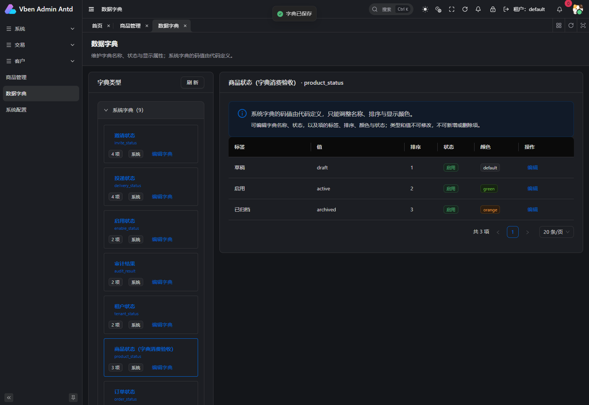
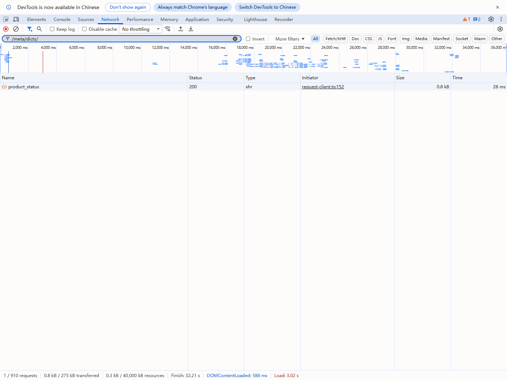

# FE-IDN-004 验收记录

- 分支：`feat/fe-idn-004-dict-consume`，基点 `906ec70`。
- 前端：`http://127.0.0.1:5666`；真实后端：`http://127.0.0.1:18080`，版本 `07abd4f`。
- 验收日期：2026-11-16。后端设计文档位于 `D:/code/go-admin-api/docs/design/dictionary-usage.md`；已核对 `api/openapi/system.yaml` 的字典接口和请求结构。
- 临时修改的商品字典名称、商品项显示属性、user_status 状态、enable_status 项标签均已恢复，见 [UI 原始记录](ui.json) 的 `cleanup`。

| # | 验收项 | 结果与证据 |
| --- | --- | --- |
| 1 | label 与颜色 | 通过。真实商品返回 `draft/草稿/default`；修改颜色后标签呈紫色。另有 DictTag 单测验证绿色、size、show-dot。[初始截图](01-label-color.png)、[修改后截图](04-product-updated-label.png)。 |
| 2 | 缺项回退 | 通过。仅将 metadata 响应替换为空数组，商品仍来自真实接口，状态显示原码 `draft`。[截图](02-missing-raw-code.png)。 |
| 3 | 接口失败 | 通过。仅将 product_status 响应替换为 HTTP 500，真实商品表仍有 20 行并显示 `draft`；没有未捕获的页面异常。[截图](03-metadata-500.png)、[UI 日志](ui.txt)。 |
| 4 | 商品状态 | 通过。在系统字典表单将标签改为「商品字典实时文案」、颜色改为 `#722ed1`，PUT 200；刷新列表及打开详情均显示新标签。[列表](04-product-updated-label.png)、[详情](04-product-detail.png)。 |
| 5 | 租户状态 | 通过。`suspended` 显示字典标签「已停用」，表内无原码。[截图](05-tenant-status.png)。 |
| 6 | 审计结果 | 通过。审计与登录历史使用 audit_result，真实元数据为 `success/成功/green`、`failure/失败/red`。[审计截图](06-audit-results.png)、[登录截图](06-login-results.png)、[原始元数据](ui.json)。 |
| 7 | 表单选项 | 通过。修改 enable_status 标签后角色表单选项显示「字典驱动启用选项」；metadata 为空时使用本地最小集合。[字典选项](07-dictionary-options.png)、[空字典兜底](07-empty-dictionary-options.png)。部门、角色、菜单表单均使用 enable_status，用户表单使用 user_status。 |
| 8 | 无硬编码 | 通过。指定三目表达式搜索无命中，`rg` 退出码 1，完整命令见下方及 [grep 日志](08-hardcoding-grep.txt)。十组清单的状态展示均已接入 DictTag；字典维护页固定选项和表单空字典兜底属于任务要求。 |
| 9 | 系统字典编辑与自举 | 通过。改中文名后 PUT 200，列表立即更新；项 label/color/sort/status 可保存，状态依次保存为 disabled/active。type/value 禁用，系统字典与项的新增/删除操作受保护。停用 user_status 后维护页仍可用本地 active/disabled 选项重新启用，metadata 请求为 0。[改名后列表](09-system-dictionary-renamed.png)、[项编辑](09-system-item-editable.png)、[项停用保存](09-system-item-disabled.png)、[自举](09-bootstrap-disabled-user-dictionary.png)。 |
| 10 | 请求复用 | 通过。20 行商品列表共一次 `GET /api/v1/meta/dicts/product_status`，HTTP 200；打开商品详情再返回列表仍合计一次。[实际网络面板](10-network-panel.png)、[面板文字](10-network-panel-text.txt)、[请求计数](10-network.json)、[脚本日志](network-ui.txt)。5 分钟缓存到期、并发合并、跨页共享、失败缓存及写入失效另有单测覆盖。 |
| 11 | lint / typecheck / unit / build | typecheck、52 个文件的 243 项单测、production build 均退出 0。本次交付范围的 lint 检查通过；全仓 `pnpm lint` 仍被预存未跟踪报告中的格式问题及重复键阻塞，见偏差说明。[类型检查](typecheck.txt)、[单测](unit.txt)、[构建](build.txt)、[全仓 lint](lint.txt)、[范围 lint](lint-scope.txt)。 |

第 8 条实际命令：

```text
rg -n -F -e "=== 'active' ? '启用'" -e "=== 'success' ? '成功'" -e "record.enabled ? '启用'" apps/admin/src
Exit code: 1
(no matches)
```

第 9 条实际保存结果：



第 10 条实际网络面板（筛选 `/meta/dicts/`，仅一行 product_status，状态 200）：



验证命令：

```text
pnpm -F @vben/web-antd typecheck
pnpm -F @vben/web-antd test:unit
pnpm -F @vben/web-antd build
node apps/admin/e2e/fe-idn-004.mjs
node apps/admin/e2e/fe-idn-004-network.mjs
```

两个浏览器脚本从 `FE_IDN_ADMIN_PASSWORD` 读取本地开发密码；可用 `FE_IDN_ORIGIN`、`FE_IDN_BACKEND`、`FE_IDN_BROWSER_CHANNEL` 覆盖本地地址和浏览器。UI 脚本只对缺项、500、空选项场景拦截 metadata；其余使用真实后端，并在 finally 恢复临时显示属性。

偏差说明：全仓 lint 的阻塞位于开始任务前已有的未跟踪目录 `docs/reports/system-dictionary-2026-11-15/`：`audit.cjs` 不符合格式规则，`curation.cjs:173` 重复定义 `unknown`。保留这些用户文件；范围 lint 使用仓库相同的 oxlint、oxfmt、eslint、stylelint 配置，仅通过命令行排除该既有目录，命令与各退出码见 [范围 lint 日志](lint-scope.txt)。因此第 11 条的「全仓 lint 全绿」尚不满足，不能宣称十一项全绿。
