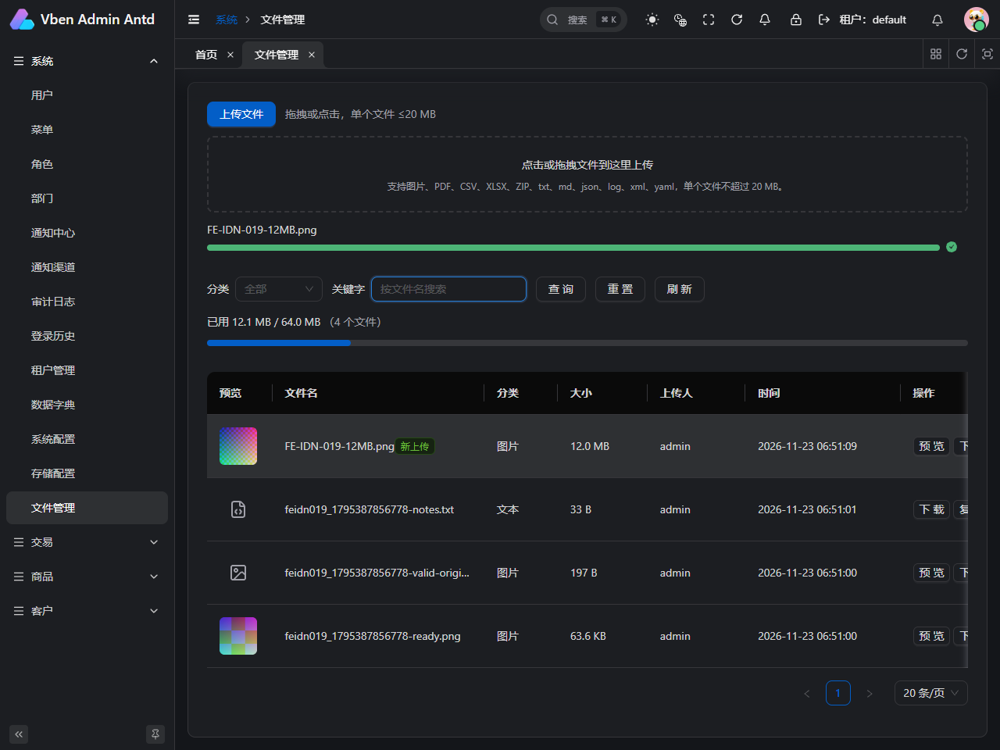

# FE-IDN-019 验收记录

日期：2026-11-23（Asia/Shanghai）。分支：`feat/fe-idn-019-thumb-status`；代码基线：`655982c5cf992a6c6f6828ad16f6d146806fb913`。后端：`6c4018a`。任务卡从 main 的文档提交 `5462474` 保留。

状态：七条验收通过。

| # | 验收 | 结果与证据 |
| --- | --- | --- |
| 1 | ready 缩略图 | 真实 PNG 上传返回 ready，浏览器成功解码缩略图；[截图](01-ready.png)。 |
| 2 | pending 占位 | 12 MB 上传返回 pending / null；48×48 占位有小转圈，悬浮显示「正在生成预览」；[截图](02-pending-tooltip.png)。 |
| 3 | 自动刷新 | 真实文件 FE-IDN-019-12MB.png，12586943 字节，2048×2048；上传后 7068 ms 自动显示缩略图，手动刷新 0 次；[截图](03-real-12MB-auto-thumbnail.png)、[列表响应时间](acceptance.json)。 |
| 4 | 停止轮询 | 全部进入 ready/failed/空后继续观察 11 秒，新增列表请求 0；[网络记录](acceptance.json)。假时钟另验证最多 12 次、无并发轮询、手动刷新重启及页面离开停止。 |
| 5 | failed / 空 | 真实 SVG 返回 failed，文本为空；均显示类型图标，观察 6 秒新增列表请求 0；[截图](05-failed-and-empty.png)。 |
| 6 | 原图预览 | 12 MB 原图为 2048×2048，下载字节 SHA-256 与上传一致；failed SVG 原图也能打开，640×360；[大图](06-large-original-preview.png)、[failed 原图](06-failed-original-preview.png)。 |
| 7 | 工程验证 | lint 退出 0；typecheck 38/38；unit 168 文件、1225 测试通过；production build 退出 0；[命令及日志](verification.json)。 |

## 操作保持与回归覆盖

后台请求沿用已应用的分类、关键字、页码与每页数量，仅更新现有行的 thumb_status / thumb_url，保持行与数组身份。真实浏览器的未提交筛选草稿不变；表格横向位置 120→120，页面纵向位置 120→120；刷新期间输入框可编辑，打开的原图弹窗保持打开。

新增 polling.test.ts 的 11 个用例验证 4999 ms 不请求、5000 ms 请求；ready/failed/空停止；十二次上限；请求不重叠；后台失败保留操作错误且有界重试；较旧响应不覆盖新查询；筛选/分页/预览状态不变；卸载和 KeepAlive 失活取消，返回重新加载。文件页相关 45 个测试通过。

## AGENTS §12 清理

使用本机开发数据库中的专属 schema `feidn019_runtime_1795387842754`、独占且初始为空的 Redis DB 14 和专属 MinIO 容器。

- 通过 DELETE /admin/files/{id} 删除本卡 4 个上传，均返回 204；原文件链接随后均为 404。删除本卡 storage provider；临时菜单配置已恢复。[API 清理](acceptance.json)、[清理结果](cleanup.json)。
- 执行 `.temp/fe-idn-019/cli.exe audit-prune --before 2026-11-22T22:51:29.441Z` → `deleted=15`。[审计清理输出](audit-prune.txt)。
- 执行 `DELETE FROM outbox_event WHERE event_type='file.cleanup' AND status='sent' RETURNING id` → 4 行。
- 执行 `DROP SCHEMA feidn019_runtime_1795387842754 CASCADE`，并移除专属 MinIO 容器、清空独占 Redis DB、停止专属前后端及 worker。
- 最终 schema / MinIO 对象与容器 / Redis 键均为 0；端口 5667 / 18081 / 19000 均关闭；原有开发业务数据及审计记录核对保留。[运行记录](runtime.json)、[最终资源复查](final-resource-check.json)。

未保留测试业务数据、临时配置或运行服务；仅保留截图、脱敏证据及本地忽略的验收脚本/二进制。

## 验收环境说明

前两次运行沿用 FE-IDN-017 夹具的 1 MB 配额，12 MB 文件被真实后端以 413 拒绝。调整隔离 provider 的两处配额赋值为 64 MB 后通过；每次尝试均执行清理，失败记录保留在 prior-attempts。没有修改后端、原有开发库配置或生产配置。

完整日志含图标解析、happy-dom teardown 和 sortable mock 的诊断输出；四项命令均退出 0，测试无失败。
